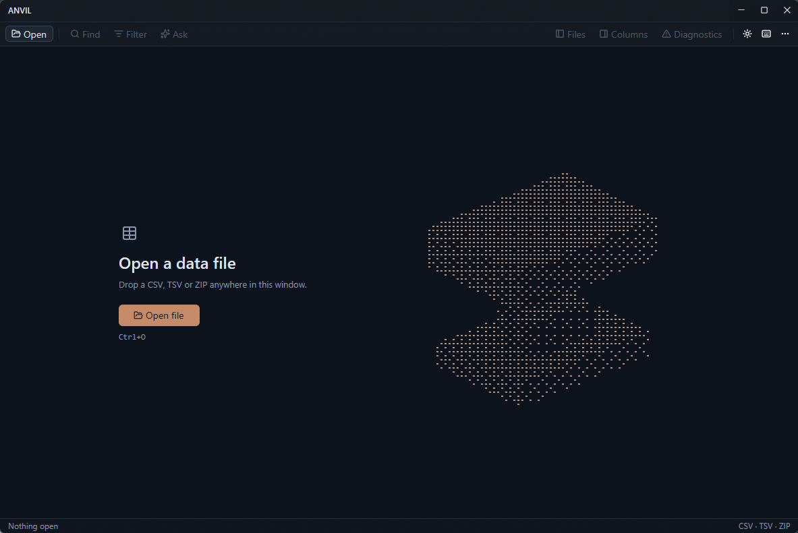

# Anvil

**A native desktop viewer for large delimited data.** Open a CSV, TSV or
ZIP export, then search, filter, sort, and investigate what is actually
inside it without loading every cell into memory.

Anvil is built in Rust on [GPUI Kit](https://crates.io/crates/gpui-kit),
using the GPUI native UI runtime. It is a single native binary with no
separate runtime to install. The redesigned shell uses Kit 0.7.0 while
retaining Anvil's custom virtualized grid.



Open a file with **Cmd/Ctrl+O** or drop a CSV, TSV, or ZIP into the window.
The quiet start workspace gives way to an opaque, information-dense grid;
its copper controls and restrained materials continue through search,
inspectors, and dialogs.

## What Anvil does

Anvil is made for the workflow of _"a customer sent me a 200 MiB export
and something is wrong with it."_ You drag the file in, and within a few
hundred milliseconds you are looking at a virtualized grid you can
search, filter, sort and inspect down to the byte.

The design that makes that possible:

- **Memory-mapped, index-only opening.** Anvil maps the file and records
  one byte offset per record. It keeps about 8 MB of index for a 165 MiB
  file and reads cell text only for the rows on screen.
- **Zip-first thinking.** A ZIP is not something you unpack first. Anvil
  reads the central directory, ranks the usable entries, and gives each
  one a tab that extracts and indexes lazily on first view.
- **Keyboard-complete.** Selection, copy, search, filter, sort,
  the column inspector and the diagnostics panel are all one keystroke
  away.
- **Diagnostics as a first-class feature.** Malformed quoting,
  inconsistent row widths, very long records, empty and duplicate
  headers, encoding problems, suspicious archive entries: each one is
  counted, listed, and clickable so you can jump straight to the row.
- **Byte-faithful display.** Every value is shown exactly as it exists in
  the file. Nothing is trimmed, rounded or reformatted: `007` stays
  `007`, `1.10` stays `1.10`, padding is preserved, and bytes that are
  not valid UTF-8 are shown escaped (`\xff`) instead of being dropped or
  replaced. The same applies to column headers and to `--probe` output.
  The grid elides long text only to fit the column; the full value is
  always in the inspector and on the clipboard.

## Features

### Open and navigate

| Capability | Detail                                                                                                                     |
| ---------- | -------------------------------------------------------------------------------------------------------------------------- |
| Formats    | CSV, TSV, PSV, and other delimiter-separated text; ZIP archives                                                            |
| Opening    | Drag and drop, the native file dialog, the window toolbar, or one positional startup path                                  |
| Grid       | Virtualized rows and columns, sticky headers, horizontal and vertical scrollbars                                           |
| Tabs       | One per document; every usable ZIP entry becomes a tab                                                                     |
| File panel | Resizable sidebar groups open documents and archive entries (`Cmd/Ctrl+B`); full-name tooltips and separate close controls |
| Selection  | Cell and range selection with shift-click and drag-select                                                                  |
| Copy       | Selection to the clipboard as TSV (`Cmd/Ctrl+C`)                                                                           |
| Headers    | Auto / On / Off, switchable per tab; forcing a mode re-indexes from the mapped source                                      |

### Native investigation workspace

- A quiet start workspace with a cached, ordered-dither anvil, a native
  Open action, and keyboard shortcut cues. No animated background or
  fabricated recent-file history.
- Native-aware titlebar, Kit command buttons and a document menu for
  Go to row, Reveal cell, header mode and archive browsing.
- Resizable Files sidebar and one right-hand tool at a time: Column,
  Diagnostics or Cell. The custom grid keeps 22 px rows and 12 px
  monospace data text, with viewport geometry shared by pane layout.
- **Anvil Slate / Anvil Warm** dark/light appearances, switchable from
  the window toolbar. Dark is the startup default; appearance is not
  persisted yet.
- Archive selection and keyboard-shortcuts help use Kit dialogs. Open
  help with the keyboard button in the window toolbar or **Cmd/Ctrl+?**
  (**Cmd/Ctrl+Shift+/**).
- Query fields retain Anvil's tested `TextEdit` behavior; this styling
  redesign does not add native IME/composition support.

Windows release builds, tests, and normal-size native UI review have passed.
Native drag/drop, resize/scaling/accessibility acceptance, and the redesigned
shell's macOS/Linux workflows are still tracked in [ROADMAP.md](ROADMAP.md).
Appearance persistence and recent-file history are not implemented.

Presentation contracts and migration details live in the
[design system](docs/design/ANVIL_DESIGN_SYSTEM.md) and
[Home workspace specification](docs/design/HOME_WORKSPACE_SPEC.md).

### Find and reshape

- **Search** (`Cmd/Ctrl+F`) streams over the document on a background
  thread, highlights every matched substring inside its cell, and jumps
  between matches with `F3` / `Shift+F3`. Scope it to one column when
  needed.
- **Filter** (`Cmd/Ctrl+L`) takes a real predicate language: `country ==
US`, `amount > 100`, `name contains "and"`, compound expressions with
  `AND`, `OR` and parentheses, and row-scope predicates such as `any
empty` (a row with a blank cell) or `all notempty`.
- **Autocomplete** suggests columns, operators and values from the
  document as you type.
- **Sort** by clicking a column header; numeric, boolean and text
  columns compare appropriately based on inferred type, and sorting
  composes with the active filter.

### Understand the data

- **Column inspector** (`Cmd/Ctrl+I`) infers each column's type and
  reports counts, distinct cardinality (exact, or a HyperLogLog estimate
  for high-cardinality columns), min/max, longest/shortest and most
  frequent values.
- **Diagnostics panel** (`Cmd/Ctrl+D`) lists every parse warning with its
  kind and row, plus a UTF-8 encoding scan reporting the BOM and any
  columns with invalid byte sequences. Clicking a row warning moves the
  grid there; offending rows carry a `⚠` marker in the row-number gutter.
- **Status bar** reports the active delimiter, row and column counts,
  filter and sort state, and the result of the last clipboard copy.

### Ask in plain language

`Cmd/Ctrl+Shift+L` opens the **Ask** bar. Type
`country is US and amount over 100` and Anvil previews the equivalent
filter expression; `Enter` hands it to the filter bar, where it stays
editable.

A deterministic rules parser handles the common shapes with no extra
install, download or dependency. Row-scope questions work in both word
orders, so `at least one column is blank`, `any row that has an empty
column` and `no column is empty` all preview correctly.

When the rules cannot resolve a phrase, optional local model backends can
interpret it (`Ctrl/Cmd+Enter` to interpret, then review and `Enter` to
apply). See [Optional natural-language backends](#optional-natural-language-backends).

## Keyboard shortcuts

| Shortcut                         | Action                                                |
| -------------------------------- | ----------------------------------------------------- |
| `Cmd/Ctrl+O`                     | Open a data file                                      |
| `Cmd/Ctrl+G`                     | Go to a display row                                   |
| `Cmd/Ctrl+Enter`                 | Reveal the cursor cell in the Cell panel (grid focus) |
| `Cmd/Ctrl+A`                     | Select all visible cells (grid focus)                 |
| `Cmd/Ctrl+C`                     | Copy the selection as TSV                             |
| `Cmd/Ctrl+F`                     | Search bar                                            |
| `Cmd/Ctrl+L`                     | Filter bar                                            |
| `Cmd/Ctrl+Shift+L`               | Ask bar                                               |
| `Cmd/Ctrl+I`                     | Column inspector                                      |
| `Cmd/Ctrl+D`                     | Diagnostics panel                                     |
| `Cmd/Ctrl+B`                     | File panel                                            |
| `F3` / `Shift+F3`                | Next / previous search match                          |
| `Cmd/Ctrl+Home` / `Cmd/Ctrl+End` | First / last row                                      |
| `Home` / `End`                   | First / last column                                   |
| `PageUp` / `PageDown`            | Move one screen, keeping one row on screen            |
| Arrows                           | Move the selection; hold `Shift` to extend it         |
| `Tab` / `Shift+Tab`              | Next / previous cell, wrapping across rows            |
| `Escape`                         | Clear the selection, or close the open overlay        |

## Build and run

```sh
cargo run --release --bin anvil                     # launch the GUI
cargo run --release --bin anvil -- FILE             # launch and open one path
cargo run --release --bin anvil -- --probe FILE     # headless open/index summary
```

`--probe <path>` runs the exact open-and-index path the UI uses and prints
a summary: delimiter, record and column counts, warnings, the BOM flag and
invalid-encoding counts. It is useful for CI and for measuring large files
without a GUI.

### Platform notes

- **macOS / Windows:** the GUI uses the native GPUI backend.
- **Linux:** Kit supplies the native platform stack, including X11 and
  Wayland support. Native packages include `libxkbcommon`,
  `libxkbcommon-x11`, `libwayland` and `freetype`; see
  `.github/workflows/ci.yml`. Native GUI behavior on Linux remains
  unverified; older backend CI does not validate the redesigned shell.
- The window opens at 1200 x 800 with a 900 x 480 minimum. Final native
  redesign validation, including both appearances and minimum-size
  workflows, remains open in the roadmap.

Generate the test fixture set on demand with:

```sh
cargo run --release --bin gen_fixture fixtures 1000000
```

That writes `fixtures/large.csv` (1,000,000 rows × 20 columns, ~165 MiB),
`fixtures/archive.zip` (the same data deflated, with `__MACOSX`,
`.DS_Store` and `README.txt` noise), `fixtures/multi.zip` (two usable CSVs
plus noise) and `fixtures/malformed.csv`. The only hand-authored fixture is
`fixtures/ask.csv`, a five-row sample for trying the Ask bar.

## Architecture

The package produces one library and two binaries. Data logic lives in
`anvil_core`, which has no GPUI dependency and is exercised headlessly by
the integration tests and by `--probe`; the `anvil` binary owns all GPUI
presentation.

```
src/
  lib.rs            anvil_core: data-side public API
  error.rs          typed errors
  loader.rs         open orchestration: path -> browsable document
  encoding.rs       UTF-8 validity / BOM scan
  source/           logical data-source abstraction
    mod.rs            DataSource, OpenedSource, MmapSource, ArchiveCandidate
    local.rs          direct filesystem files
    archive.rs        ZIP discovery, safety checks, extraction to temp
  parser/
    mod.rs            Cells iterator, Cell, ParsedDocument
    delimit.rs        quote-aware delimiter + header detection
    indexing.rs       record byte-offset index, diagnostics
  selection.rs      selection model (GPUI-free)
  schema.rs         heuristic per-column type inference
  schema/stats.rs   column statistics for the inspector
  query.rs          search + match-range helpers (GPUI-free)
  query/filter.rs   predicate filter: parse + apply
  query/sort.rs     column sort (keyed permutation)
  query/suggest.rs  filter autocomplete from slot context
  query/nl.rs       Tier 1 deterministic natural language -> FilterExpr
  gliner.rs         Tier 2 GLiNER extraction backend (optional feature)
  nlmodel.rs        Tier 2 generative model backend (optional feature)
  ui/               GPUI presentation (binary only)
    app.rs            window lifecycle
    view.rs           document state + orchestration + composition
    view/shell.rs     native titlebar + toolbar/menu + welcome + startup
    view/workspace.rs resizable panes + shared grid viewport geometry
    view/archive_dialog.rs Kit archive chooser lifecycle
    view/search.rs     search bar (state, render, editing)
    view/filter.rs     filter bar (apply, render, editing)
    view/ask.rs        Ask bar (preview, interpretation, apply)
    view/diagnostics.rs warnings panel + click-to-navigate
    view/tests.rs      headless UI + unit test suite
    input.rs          shared editable-text rendering / hit-testing
    text_edit.rs      GPUI-free single-line edit buffer
    commands.rs       keyboard chord -> action binding table
    grid.rs           column layout + row rendering helpers
    archive_picker.rs archive presentation helpers
    theme.rs          Slate/Warm Kit themes + semantic Palette + grid metrics
  main.rs           binary entry: GUI, `--probe`, `--ask-probe`, `--setup-ask-model`
  bin/gen_fixture.rs synthetic CSV + ZIP generator
```

### Data representation

Opening a file keeps exactly one thing in memory: the record index.

- The source file is memory-mapped (`memmap2`).
- Indexing walks the bytes once and records the **start byte offset of
  every record** in a `Vec<u64>` (the last entry is the file length, so
  every record has an exclusive end). Quotes are tracked with an explicit
  `at_field_start` flag, so delimiters and newlines inside quoted fields
  are handled correctly.
- The grid asks for a specific `(row, column)`. The document slices the
  mmap for that record's byte range, runs a small state machine over it,
  and returns a borrowed `Cow` for the cell, so no per-row storage is
  retained.

For the 165 MiB fixture that index costs about **8 MB** of `u64`s and
roughly **250-340 ms** (≈470 MiB/s) on a page-cache-warm mmap.

### ZIP handling

`open_path` sniffs the first four bytes without reading the whole file. A
ZIP becomes an `ArchiveSource` which:

1. lists entries and classifies each one,
2. rejects directories, `__MACOSX`, `.DS_Store`, hidden files, `..`
   paths, encrypted entries, unsupported compression methods, and
   oversized or zip-bomb-ratio entries, recording a reason for each,
3. ranks usable entries by extension (`csv`/`tsv` > `dat` > `txt`),
4. auto-opens the single best-ranked entry when there is a clear
   favourite, and otherwise presents the choice.

Skipped entries appear in the **Archive…** overlay with their reasons. In
the GUI every usable entry becomes its own tab immediately (the central
directory already lists names and sizes). The entry the loader pre-opened
is ready; the others extract and index lazily when their tab is first
activated. Each entry is decompressed to a `tempfile`, then memory-mapped
and indexed through the _same_ path as a normal file. The temp directory
is kept alive by an `Arc<TempDir>` inside `OpenedSource` and removed on
drop.

### Threading and cancellation

Opening, extraction, indexing, search, sort, the inspector scan and the
encoding scan all run on GPUI's background executor. Each of them carries
a generation counter, and a result whose generation is stale is dropped,
so opening a new file while a large archive is still indexing is safe and
never publishes outdated state. The UI thread renders the finished index
and never performs a large scan.

## Optional natural-language backends

Both backends are opt-in Cargo features. The default build is unchanged
by them. Every model result is re-validated by the filter parser before it
can become a query, and the Ask bar shows the preview first.

### GLiNER extraction (`nl-gliner`)

[GLiNER2.5 Small](docs/adr/0002-native-gliner-ask.md) runs locally inside
Anvil through Candle. Install its roughly 296 MB weights plus tokenizer
once, then launch the enabled build:

```sh
cargo run --release --features nl-gliner --bin anvil -- --setup-ask-model
cargo run --release --features nl-gliner --bin anvil
```

Open Ask with `Cmd/Ctrl+Shift+L`. When the rules cannot resolve a phrase,
`Ctrl/Cmd+Enter` interprets it, and `Enter` applies it once the preview
looks right. This backend resolves one condition per question, such as
`Last names that start with C`, and it resolves indirect columns by
sampled value: `Which users are from Canada?` binds `Canada` to the column
whose sampled values uniquely contain it, producing `country == Canada`.
When two columns contain the value, it asks instead of guessing. The
filter bar covers compound queries, aggregation, sorting and dates.

The model stays loaded after first use and inference runs on a background
executor. Only `--setup-ask-model` reaches the network, downloading from a
pinned Hugging Face revision and reporting per-file progress in the
terminal. Files live in the program's `anvil-data/models` folder next to
the executable, under a revision-specific GLiNER folder, so the install
stays self-contained; `ANVIL_DATA_DIR` overrides the data root,
`ANVIL_NL_CACHE` overrides the models root, and
`ANVIL_GLINER_MODEL_DIR` selects a checkpoint directory
containing `config.json`, `encoder_config/config.json`, `tokenizer.json`
and `model.safetensors`.

Requests are bounded: 512 bytes per question, 32 columns, 1024 bytes of
column names, and 512 encoded tokens including the extraction schema.
Oversized requests fail fast with the limit named. Low-confidence or
invalid outputs report an error rather than applying a query.

For a repeatable real-model check (after setup):

```sh
cargo test --release --features nl-gliner real_model_filter_smoke -- --ignored --nocapture
cargo run --release --features nl-gliner --bin anvil -- --ask-probe fixtures/large.csv "amount exceeds 100"
```

`nl-gliner` takes precedence when both model features are enabled. The
community `gliner-rs` dependency is pinned to 0.2.3 and shares Candle 0.11
with the generative backend below.

### Generative model (`nl-model`)

The alternative backend downloads a small local instruct model (default
`Qwen2.5-Coder-1.5B-Instruct` Q4_K_M, about 1.1 GB) on first use and then
runs entirely on CPU:

```sh
cargo run --release --features nl-model --bin anvil
```

`Ctrl/Cmd+Enter` in the Ask bar escalates an unresolved phrase to it.
Model files are cached under `<program folder>/anvil-data/models`, beside
the executable (`ANVIL_DATA_DIR` / `ANVIL_NL_CACHE` override it), so
removing the program folder removes the download too.

Both Llama-architecture (SmolLM2) and Qwen2-architecture (Qwen2.5) GGUFs
load; the family is read from the GGUF metadata. Code-tuned or strongly
instruction-tuned instruct models in the 0.5B-1.5B range work best with
the standard ChatML prompt.

Overrides: `ANVIL_NL_MODEL_REPO` / `ANVIL_NL_MODEL_FILE`,
`ANVIL_NL_TOKENIZER_REPO` / `ANVIL_NL_TOKENIZER_FILE`, `ANVIL_NL_ENDPOINT`
(a mirror), `ANVIL_NL_CACHE` (cache location), and `HF_TOKEN` (for gated
models). For a lighter download, swap in Qwen2.5-Coder-0.5B-Instruct
(about 470 MB) by pointing those variables at its GGUF.

## Testing

```sh
cargo test       # data-side, UI and style suites
cargo clippy --release
```

The performance tests are `#[ignore]`d and need a generated fixture:

```sh
cargo test --release --test core -- --ignored measure_large   # indexing
cargo test --release --test core -- --ignored measure_search  # case-insensitive search
cargo test --release --test core -- --ignored measure_filter  # predicate filter
cargo test --release --test core -- --ignored measure_sort    # numeric sort
cargo test --release --bin anvil measure_wide_column_layout -- --ignored --nocapture
```

Coverage includes normal, quoted, TSV, semicolon and pipe input, embedded
newlines, escaped quotes, missing and empty values, duplicate and empty
headers, inconsistent rows, extremely wide files, extremely long cells,
headerless and newline-less files, a 100k-row synthetic dataset,
single- and multi-file ZIPs, nested paths, `__MACOSX`, corrupted ZIPs,
path traversal, duplicate entry names, a large compressed CSV, compound
filter expressions with context-aware autocomplete, and row-scope
`any` / `all` predicates.

## Documentation

- `VISION.md` — durable product intent.
- `ROADMAP.md` — milestone-by-milestone plan; checkboxes reflect the
  actual repository state.
- `ARCHITECTURE.md` — current technical architecture.
- [docs/ui-design.md](docs/ui-design.md) — Kit workspace design conventions
  and native acceptance checklist.
- `AGENTS.md` — operating manual for coding agents working in this
  repository.
- `docs/adr/` — architectural decision records.
- `docs/agent-log.md` — chronological handoff log.
- `docs/prompts/initial-anvil-prompt.md` — historical product brief.

## Status

Milestones 1-3 are implemented, with conveniences such as tab reordering,
recently-closed tabs and saved filters still open. Go-to-row and
current-view inspector scans are implemented. Milestone 4 (diagnostics and data quality) is complete apart
from click-to-navigate for header-level warnings. Milestone 5
(performance and UX hardening) and Milestone 6 (natural-language Ask,
opt-in) are in progress. `ROADMAP.md` holds the authoritative list, with
acceptance criteria and the evidence behind each checked box.
